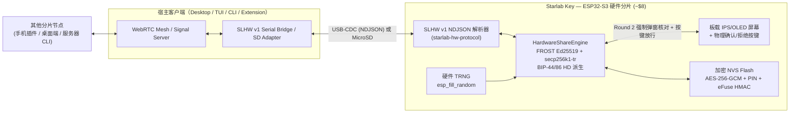
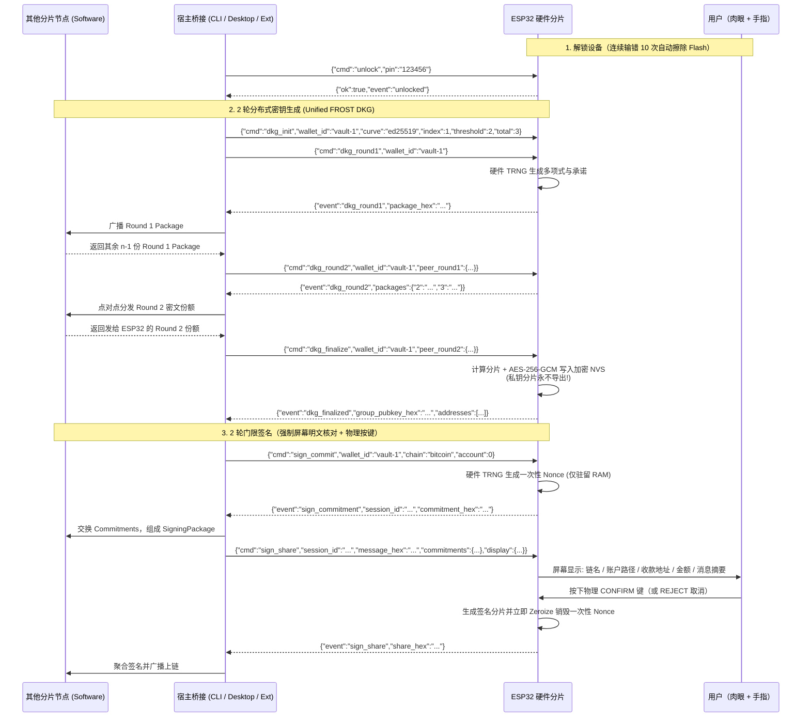

# Starlab Key — ESP32 低成本开源硬件分片方案 (Open-Source Hardware MPC Share)

> **核心理念**：传统硬件钱包（Ledger / Trezor，\$80–\$250）必须在单颗安全芯片里扛住全部单点风险；而 **Starlab MPC 门限架构（如 2-of-3）** 把信任分散到了多台异构设备。  
> 用一块 **¥25–¥75（\$3.5–\$10）** 随手买得到的 **ESP32-S3 / ESP32-C3** 开发板作为其中一个硬件分片：
> - **即使硬件丢失或被物理拆解读取 Flash**：单个分片在信息论意义上泄露 **0 bit 私钥**，攻击者无法动用任何资金；
> - **日常签名时**：必须在本机屏幕上肉眼核对链/地址/摘要，并**按下物理确认按键（What You See Is What You Sign）**，才能产出第 2 份签名分片，彻底拦截电脑木马静默盗签；
> - **100% 开源可复现**：直接复用 `starlab-core` 同源 Rust `frost-core 3.0` 密码库，支持免焊接成品板刷机，零黑盒固件。

---

## 1. 三档零门槛硬件选型与 BOM 成本表

所有方案均无需自画 PCB，淘宝 / 立创 / AliExpress 现货采购，USB-C 插上电脑 60 秒刷入开源固件即可使用：

| 方案档位 | 推荐主控板（零焊接现货） | 核心规格 | 外设配置 | 预估成本 | 适用场景 |
| :--- | :--- | :--- | :--- | :---: | :--- |
| **Tier A · 极客极简版** | **ESP32-C3 SuperMini** 或 **Seeed XIAO ESP32-C3** + 0.96" I2C OLED (SSD1306) + 2×微动开关 | RISC-V 160MHz · 400KB SRAM · 4MB Flash · 原生 USB-CDC | 128×64 OLED + 确认/拒绝键 | **¥25 – ¥35** (\$3.5 – \$5) | 极低成本 DIY / 批量分发给团队成员作 2-of-3 冷分片 |
| **Tier B · 推荐一体成品版 ⭐** | **LilyGO T-Display-S3**（或 **Waveshare ESP32-S3-LCD-1.47** / **M5Stack AtomS3**） | **ESP32-S3 N16R8** 双核 240MHz · 512KB SRAM + **8MB PSRAM** · 16MB Flash · **内置 4096-bit RSA 硬件加速器** | **板载 1.9" IPS 彩屏 + 2 颗物理按键 + USB-C**（零焊接！） | **¥55 – ¥75** (\$8 – \$10) | **主力推荐**：买来零焊接直接刷机，套上 3D 打印壳即成品硬件分片；为 v1.5 CGGMP24 EVM 留足 PSRAM |
| **Tier C · 全气隙冷签版** | **ESP32-S3 2.8" LCD (CYD-S3 / ESP32-2432S028R-S3)** | ESP32-S3 · 8MB PSRAM · 16MB Flash | **2.8" 大屏 + 板载 MicroSD 卡槽** | **¥65 – ¥85** (\$9 – \$12) | 永不插联网电脑，通过 MicroSD 卡（`starlab_export/` & `starlab_import/`）完成全离线气隙 DKG 与冷签 |

> **为什么推荐 ESP32-S3 (Tier B) 作为标准参考硬件？**
> 1. **原生 USB Serial/JTAG (USB-CDC)**：无需 CH340/CP2102 串口芯片，插线即识别，后续还可直接对接浏览器 **WebSerial** 实现网页一键刷机与插件直连。
> 2. **硬件安全外设齐全**：内置真随机数发生器（TRNG）、**HMAC eFuse 硬件密钥槽**、**AES-256-XTS Flash 加密**、**Secure Boot V2** 以及 **4096-bit BigNum/RSA 硬件加速器**。
> 3. **16MB Flash + 8MB PSRAM**：不仅轻松运行 FROST（< 64KB RAM），还为下一阶段在片上运行 CGGMP24 3072-bit Paillier 门限 ECDSA 预留了完整内存与算力空间。

---

## 2. 系统架构与通信拓扑

ESP32 硬件分片不直接跑重型 WebRTC 协议栈，而是作为一台**纯密码学协处理器 + 物理确认终端**，通过两条极简通道接入现有 Starlab 生态：
1. **USB-CDC 串口直连（SLHW v1 NDJSON 协议）**：接在安装了 Starlab Desktop / CLI / Chrome 插件（WebSerial）的宿主设备上，宿主仅充当哑管道转发密文/公开承诺，**私密分片永远不离开 ESP32 Flash**；
2. **MicroSD 离线气隙模式**：完全兼容 `apps/tui/src/core/offline_manager.rs` 定义的 `starlab_export/` 与 `starlab_import/` 目录及 `OfflineDataPackage` JSON 格式，无需任何有线/无线连接即可与桌面端 / TUI 完成空气隔离多签。



---

## 3. 2 轮 DKG 与物理按键冷签时序



---

## 4. 密码学曲线支持与路线图（诚实工程评估）

| 能力 | 曲线 / 协议 | 对应公链 | RAM / Flash 占用 | ESP32-S3 单轮耗时 | 状态 |
| :--- | :--- | :--- | :---: | :---: | :---: |
| **FROST Ed25519** | `frost-ed25519 3.0` + BIP-44 HD | Solana, Sui, Aptos, TON, Near, Stellar… | ~40 KB RAM · ~2.4 KB/钱包 | **~15 ms** | **v1 已实现并完成互操作测试 ✅** |
| **FROST secp256k1 Taproot** | `frost-secp256k1-tr 3.0` + BIP-86 P2TR | Bitcoin Taproot (`bc1p…`) | ~48 KB RAM · ~2.6 KB/钱包 | **~28 ms** | **v1 已实现并完成互操作测试 ✅** |
| **MicroSD 气隙协议** | `OfflineDataPackage` (`starlab_export`/`import`) | 离线冷签与离线 DKG | < 4 KB 缓冲 | 瞬时 | **v1 已实现并测试 ✅** |
| **Threshold ECDSA (CGGMP24)** | `cggmp24 0.7` (3072-bit Paillier + ZK) | Ethereum & 100+ EVM 链 | ~1.8 MB PSRAM · ~18 KB/钱包 | 见下方说明 | **v1.5 路线图（仅限 ESP32-S3 8MB PSRAM）** |

### 为什么 v1 先交付纯 FROST，v1.5 再上 ESP32-S3 CGGMP24？
- **诚实面对算力瓶颈**：`cggmp24` (`SecurityLevel128`) 需要生成 4 个 1536-bit 安全素数（组成 3072-bit Paillier 模数）。纯软件大数运算在桌面 x86_64 上需 ~1.5 分钟，在 240MHz 单片机上纯软件跑需 20–40 分钟，体验不可接受。
- **v1.5 破解方案（仅 ESP32-S3 N16R8）**：
  1. **调用 ESP32-S3 内置 4096-bit RSA/BigNum 硬件加速器（`ESP_RSA` / `mbedtls_mpi_exp_mod`）**：将 3072-bit 模幂卸载到硬件乘法器，单次 Paillier 加密/解密与 ZK 证明可提速 **10×–30×**（进入 1–3 秒级可用区间）；
  2. **安全素数预生成优化**：插入 USB 电源闲时后台预生成缓存到加密 NVS，或由宿主提供随机偏移候选区间、由 ESP32 硬件 RSA 引擎在片上独立完成 Miller-Rabin + Lucas 素性验证（< 2 秒），同时不泄露素数秘密。
- **在 v1.5 落地前**：用户可用 **桌面端 + 浏览器插件** 完成 2-of-2 / 2-of-3 的 EVM (CGGMP24) 签名，同时用 **ESP32-S3 硬件分片** 守护高价值 **Bitcoin Taproot / Solana / Sui** 资产，两条曲线共享同一套 `SLHW v1` 串口协议无缝演进。

---

## 5. 安全模型与纵深防御设计

虽然 ESP32 不是 CC EAL6+ 安全元件（SE），但结合 **MPC 门限密码学 + ESP32 硬件安全特性**，它实现了极高的性价比安全边界：

1. **无单点密钥泄露（MPC 本质优势）**：
   - 芯片里永远只存 $s_i$（1 份门限分片），不存在完整私钥或助记词。即便攻击者花高成本做电磁故障注入/拆片读出 Flash，没有其他 $t-1$ 台设备配合依然无法伪造签名。
2. **协议层禁止导出私钥**：
   - `SLHW v1` 指令集中**不存在任何 `export_secret_share` 命令**；只能导出公开的 `PublicKeyPackage` 和派生地址。
3. **一次性 Nonce 强制 Zeroize 防重放攻击**：
   - FROST 协议中，同一组 Nonce 若对两条不同消息签名会直接泄露分片私钥。
   - 固件在 `sign_share` 执行前用 `Option::take()` 立即取出并消费内存中的 Nonce：无论用户按**拒绝键**、超时还是校验失败，Nonce 都会立刻被 `zeroize` 清零销毁，绝无复用可能。
4. **物理按键防静默盗签（Clear Signing）**：
   - `sign_share`（Round 2）**必须**阻塞等待 `HardwareHal::confirm_signing(&SignDisplayInfo)` 返回物理按键 `Approve`；屏幕明文展示链名、派生路径、地址、摘要前缀（前 16 hex + 后 16 hex）及可选金额/收款方提示。
5. **PIN + 硬件 eFuse 双因素加密存储 + 暴力破解自毁**：
   - 加密密钥派生：`KEK = HKDF-SHA256(PBKDF2-HMAC-SHA256(PIN, salt, 60_000), ESP32_EFUSE_HMAC_SECRET)`；
   - NVS 中所有分片以 **AES-256-GCM** 密文落盘，且每次写入随机生成 96-bit Nonce；
   - 持久化错误计数器：连续输错 **10 次 PIN** 自动调用 `wipe_all()` 不可逆清除全部加密分片。
6. **生产固件加固（`hardware/esp32-share/sdkconfig.release`）**：
   - 开启 **Flash Encryption (Release Mode, AES-256-XTS)**；
   - 开启 **Secure Boot V2**（防止恶意串口重刷偷取 NVS）；
   - 熔断关闭 **JTAG / USB-JTAG 调试接口**，仅保留 USB-CDC 串口通信。

---

## 6. `SLHW v1` 串口与气隙通信协议规范

### 6.1 传输层
- **USB-CDC / UART0**：`115200`（或 `921600`）bps，8N1，**每行一条 JSON（NDJSON，`\n` 结尾）**。
- **帧大小约束**：所有单条命令/响应帧严格 **< 4 KB**（实测 FROST 2-of-3 Round 1/2 与签名帧均 **< 1.2 KB**），既适配单片机小串口缓冲区，也直接适配 **静态/分片二维码** 扫描。

### 6.2 指令集一览

| 指令 `cmd` | 需解锁 | 需物理按键 | 作用 |
| :--- | :---: | :---: | :--- |
| `ping` | 否 | 否 | 探活与协议版本握手 (`SLHW v1`) |
| `device_info` | 否 | 否 | 查询芯片型号、固件版本、支持曲线、锁定状态、剩余 PIN 尝试次数 |
| `set_pin` | 首次免 | 否 | 初始化设备 PIN（仅未初始化时允许，或已解锁改密） |
| `unlock` / `lock` | 否 | 否 | PIN 解锁（失败计数，10 次自毁）/ 立即锁定并清零内存密钥 |
| `list_wallets` | 否 | 否 | 列出已存钱包元数据（名称、曲线、群公钥、门限 `t/n`，不含私钥） |
| `derive_address` | 否 | 否 | 公钥本地派生指定链与账户号 `account` 的收款地址（BTC `bc1p…` / SOL / SUI） |
| `dkg_init` | 是 | 否 | 初始化一轮 FROST DKG 会话（指定 `wallet_id`, `curve`, `index`, `threshold`, `total`） |
| `dkg_round1` | 是 | 否 | 用硬件 TRNG 生成 Round 1 Package（返回 FROST 二进制 hex） |
| `dkg_round2` | 是 | 否 | 接收其余 $n-1$ 个节点的 Round 1 包，生成发给每个对端的 Round 2 包 |
| `dkg_finalize` | 是 | 否 | 校验并合成分片，AES-256-GCM 加密写入 NVS，返回群公钥与 Account 0 地址 |
| `sign_commit` | 是 | 否 | Round 1：派生指定链/账户子分片，生成一次性 Nonce（仅存 RAM）并返回 Commitment |
| `sign_share` | 是 | **是（强制）** | Round 2：屏幕明文展示交易信息 → 等待用户按物理确认键 → 输出 SignatureShare 并销毁 Nonce |
| `delete_wallet` | 是 | **是（强制）** | 物理确认后删除指定钱包分片 |
| `sd_import_package` | 是 | 视类型 | 处理来自 MicroSD `starlab_import/` 的 `OfflineDataPackage` 并输出对应 `starlab_export/` 包 |

### 6.3 典型交互报文示例

```json
// 1) 探活
-> {"id":1,"cmd":"device_info"}
<- {"id":1,"ok":true,"data":{"event":"device_info","protocol_version":1,"firmware_version":"0.1.0","board":"lilygo-t-display-s3","chip":"ESP32-S3","curves":["ed25519","secp256k1"],"pin_configured":true,"unlocked":false,"remaining_pin_attempts":10,"wallet_count":1}}

// 2) Round 1 承诺（Bitcoin Taproot Account #0）
-> {"id":10,"cmd":"sign_commit","wallet_id":"treasury","chain":"bitcoin","account":0}
<- {"id":10,"ok":true,"data":{"event":"sign_commitment","session_id":"s-0001","curve":"secp256k1","chain":"bitcoin","account":0,"path":"m/86'/0'/0'/0/0","address":"bc1p...","participant_index":1,"commitment_hex":"..."}}

// 3) Round 2 签名分片（触发 ESP32 屏幕核对 + 物理确认键）
-> {"id":11,"cmd":"sign_share","session_id":"s-0001","message_hex":"a1b2...64hex","commitments":{"1":"...","2":"..."},"display":{"summary":"Send 0.05 BTC","recipient":"bc1p...","amount":"0.05 BTC"}}
<- {"id":11,"ok":true,"data":{"event":"sign_share","session_id":"s-0001","participant_index":1,"share_hex":"..."}}
```

---

## 7. 参考接线与引脚映射

| 参考板型 | Cargo Feature | Approve 按键 | Reject 按键 | 屏幕接口 | MicroSD (SPI) |
| :--- | :--- | :---: | :---: | :--- | :--- |
| **LilyGO T-Display-S3** ⭐ | `board-t-display-s3` | `GPIO0` (左/BOOT) | `GPIO14` (右按键) | 1.9" ST7789 8-bit 并口 (板载) | 可外接或走 USB-CDC |
| **XIAO ESP32-C3 + OLED** | `board-xiao-c3` | `GPIO2` (下拉/内上拉) | `GPIO3` | I2C SSD1306 (`SDA=GPIO6`, `SCL=GPIO7`) | 走 USB-CDC |
| **CYD-S3 2.8" LCD** | `board-cyd-s3` | `GPIO0` / 触摸确认区 | 触摸拒绝区 | 2.8" ILI9341/ST7789 SPI (板载) | 板载 TF (`CS=10, MOSI=11, CLK=12, MISO=13`) |
| **ESP32-S3 DevKitC-1** | `board-devkit-s3` | `GPIO0` (BOOT) | `GPIO4` (外接按钮) | I2C SSD1306 (`SDA=GPIO8`, `SCL=GPIO9`) | 走 USB-CDC |

### 开源 3D 打印外壳建议
- **LilyGO T-Display-S3 社区现货外壳**：Printables / MakerWorld 已有数十款开源 STL（搜索 `LilyGO T-Display-S3 case`），PLA/PETG 单壳打印成本 **< ¥3**，留有 USB-C 开孔与双侧按键帽，直接套上即成品。

---

## 8. 代码仓库结构与验证方式

本方案已在仓库内落地完整协议核心、模拟器、真实跨端密码学互操作测试及 ESP-IDF 固件模板：

1. **跨平台核心协议库**：[`packages/@starlab/hw-protocol/`](../packages/@starlab/hw-protocol/)
   - `HardwareShareEngine<H: HardwareHal>`：一套 Rust 代码同时跑在 **真实 ESP32 固件** 与 **宿主机模拟器** 上，100% 复用 `starlab-core` 的 FROST 3.0 与 BIP-44/86 派生逻辑；
   - **零硬件即可跑通端到端真实密码学测试**：
     ```bash
     cargo test -p starlab-hw-protocol
     ```
   - **交互式虚拟 ESP32 串口模拟器**（stdin/stdout 即模拟 `/dev/ttyACM0`）：
     ```bash
     cargo run -p starlab-hw-protocol --example esp32_sim_bridge
     ```
2. **ESP32-S3 / C3 真实固件工程**：[`hardware/esp32-share/`](../hardware/esp32-share/)
   - 包含 `Cargo.toml`、`sdkconfig.defaults`、`sdkconfig.release`（Flash 加密 + Secure Boot V2）、`partitions.csv`、`board.rs`、`esp_hal.rs`、`display.rs`、`main.rs` 与一键刷机脚本 `flash.sh`。
3. **未来一步：Chrome 浏览器一键免安装刷机（WebSerial + `esp-web-tools`）**
   - 在 GitHub Actions 中使用 `esp-rs/esp-idf` 容器自动编译 `lilygo-t-display-s3.bin` / `xiao-esp32c3.bin` 并发布到 GitHub Releases；
   - 在 `https://wallet.starslab.qzz.io` 挂一个 `<esp-web-install-button>`，小白买块 ¥60 的 LilyGO 板子插上 Chrome，点一下按钮就能刷好自己的开源 MPC 硬件冷分片！
